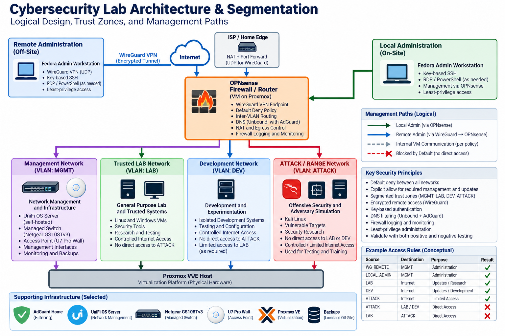
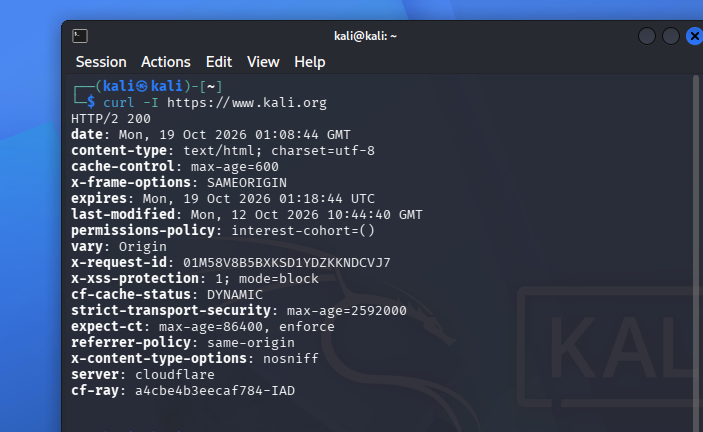
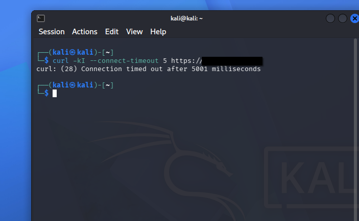
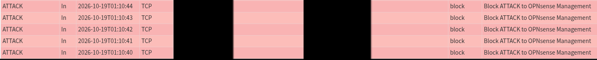
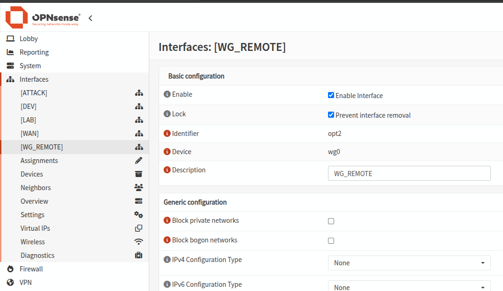

# Cybersecurity Lab Architecture & Segmentation

A segmented cybersecurity and digital-forensics lab built on Proxmox with OPNsense providing routing, firewall enforcement, DNS/DHCP services for selected zones, and controlled remote access. The environment separates trusted forensic-analysis systems, development workloads, and an offensive-security range from the household network while preserving tightly scoped administrative and Internet-update paths.

## At a Glance

| Area | Design |
|---|---|
| **Platform** | Proxmox VE with OPNsense as the lab firewall/router |
| **Trust zones** | Home, Trusted LAB, DEV, ATTACK/RANGE, WG_REMOTE |
| **Security model** | Default deny with explicit management, DNS, and update paths |
| **Administration** | Hardened Fedora workstation; key-only SSH; RDP and PowerShell-over-SSH where required |
| **Remote access** | WireGuard terminated on OPNsense; split tunnel; least-privilege service rules |
| **Validation** | Positive and negative controls verified with firewall/service evidence |
| **Primary outcome** | Offensive, development, and forensic workloads remain separated while approved administration and update paths remain functional |

**Core technologies:** Proxmox VE, OPNsense, WireGuard, Fedora Linux, Kali Linux, SIFT, Windows 11, OpenSSH, PowerShell, AdGuard Home, UniFi OS Server, Ubiquiti U7 Pro Wall, Netgear GS108Tv3

---

## Architecture

*Figure 1. Sanitized logical architecture showing trust zones and management paths.*

The logical design centers on OPNsense as the policy-enforcement point for the internal lab networks.

Locally, the Fedora administration workstation reaches internal lab networks through OPNsense using explicit routes and tightly scoped firewall rules. Remotely, the same workstation reaches the environment through a WireGuard tunnel terminating on OPNsense; only approved management services are permitted from the remote-access zone.

The current wireless prototype remains on the Home LAN. Trusted LAB and DEV remain internal Proxmox networks, while ATTACK/RANGE is a separate internal Proxmox bridge with its own OPNsense interface, DHCP, DNS, firewall policy, and source NAT. Physical VLAN/SSID extension is intentionally future work rather than a claimed completed capability.

### Trust Zones

| Zone | Purpose | Security intent |
|---|---|---|
| **Home** | Household systems and infrastructure | Protected from lab-originated access |
| **Trusted LAB** | SIFT and Windows DFIR systems | Analyst environment isolated from DEV and ATTACK |
| **DEV** | Development and curriculum workloads | Restricted; no default access to household or analyst systems |
| **ATTACK / RANGE** | Kali and authorized offensive-security exercises | Lowest-trust permanent lab zone; cannot initiate into protected networks |
| **WG_REMOTE** | Remote administrative entry point | Least-privilege access only to approved management services |

---

## Design Goals

The environment had to support realistic security work without turning the home network into part of the lab.

The main requirements were:

- isolate offensive, development, and forensic workloads from one another;
- protect household systems and management planes from lab-originated traffic;
- allow only the Internet access necessary for updates and normal research;
- centralize routing and firewall enforcement in OPNsense;
- administer Linux and Windows systems securely from a dedicated workstation;
- support remote management without directly exposing SSH, RDP, Proxmox, OPNsense, AdGuard, or UniFi management interfaces to the Internet;
- preserve rollback and recovery evidence before major infrastructure changes.

---

## Security Model

### Default-Deny Segmentation

The design follows a simple principle: **permit the required path, then prove that adjacent paths remain blocked.**

Representative policy includes:

- DEV → Home: blocked and logged
- DEV → Trusted LAB: blocked and logged
- DEV → OPNsense management: blocked
- LAB → Home: blocked and logged
- LAB → DEV: blocked and logged
- LAB → OPNsense management: blocked except explicitly required services
- ATTACK → Home / LAB / DEV / WG_REMOTE: blocked and logged
- ATTACK → OPNsense management: blocked
- ATTACK → Internet: limited web/update access after protected-destination deny rules
- WG_REMOTE → management services: explicit service-by-service allow rules only

This lets systems receive updates and perform their intended roles without treating Internet access as justification for broad lateral reachability.

### Administrative Access

The primary management endpoint is a Fedora workstation configured with full-disk encryption, Secure Boot, SELinux enforcing, firewalld, minimal inbound exposure, and no local SSH server.

The workstation initiates management connections into the lab. Linux systems use key-only OpenSSH. The Windows DFIR workstation supports key-only OpenSSH, RDP from the approved management source, and PowerShell remoting over SSH. Password SSH authentication is disabled on the managed lab workstations.

### Remote Access

WireGuard terminates on OPNsense. The remote client uses split tunneling for lab networks and approved management destinations.

Remote-access rules permit only selected services such as DNS, SSH, RDP, PowerShell-over-SSH, and specific browser-based management interfaces. No broad rule grants unrestricted access to the household LAN.

---

## Validation Matrix

The security model was tested with both **positive controls** and **negative controls**. The goal was to verify actual runtime behavior rather than assume that a GUI configuration represented enforcement.

| Test path | Expected result | Observed result | Evidence / validation |
|---|---|---|---|
| ATTACK → DNS | Allowed | Passed | Name resolution succeeded after Unbound interface correction |
| ATTACK → Internet HTTPS | Allowed | Passed | HTTPS update/research path succeeded |
| ATTACK → Home | Denied | Denied | Negative-control test + firewall log |
| ATTACK → Trusted LAB | Denied | Denied | Negative-control test + firewall log |
| ATTACK → DEV | Denied | Denied | Negative-control test + firewall log |
| ATTACK → WG_REMOTE | Denied | Denied | Negative-control test + firewall log |
| ATTACK → Proxmox / OPNsense management | Denied | Denied after rule-order correction | Negative-control test + firewall log |
| Local admin → SIFT / Linux hosts | Allowed | Passed | Key-only SSH validation |
| Local admin → Windows DFIR | Allowed | Passed | RDP, OpenSSH, and PowerShell-over-SSH validation |
| Remote admin → approved lab services | Allowed | Passed | Off-network WireGuard test |
| Remote admin → unrelated Home targets | Denied | Denied | Negative-control remote-access testing |
| WireGuard after link interruption / OPNsense reboot | Recover | Recovered | Reconnection testing after interruption and reboot |

---

## Validation Evidence

### Positive Control — ATTACK → Internet HTTPS

*Figure 2. Positive control: the ATTACK-zone Kali system successfully reached an approved Internet HTTPS destination and received HTTP 200.*

### Negative Control — ATTACK → Protected Management

*Figure 3. Negative control: the ATTACK-zone Kali system attempted HTTPS access to a protected management target and timed out.*

*Figure 4. Corroborating firewall evidence: OPNsense logged the ATTACK-zone connection as blocked by the explicit `Block ATTACK to OPNsense Management` rule.*

The negative-control result is treated as a two-part proof: the client failed to establish the application connection, and the firewall independently recorded the corresponding deny decision.

### WireGuard Corrected State

*Figure 5. Current corrected state: the WG_REMOTE interface is enabled in OPNsense. The earlier troubleshooting case involved an assigned-but-disabled interface, which prevented the expected generated PF pass rule from becoming active.*

---

## Troubleshooting Cases

### 1. A Web Rule That Was Too Broad

An ATTACK-zone rule intended to permit TCP/80 and TCP/443 Internet access also allowed HTTPS access to OPNsense because the port was constrained but the destination was not constrained strongly enough.

**Evidence:** Negative-control testing exposed unexpected management-plane reachability.

**Correction:** Protected destinations were denied before the broader Internet web-access rule.

**Lesson:** A permitted application port does not imply a permitted destination. Destination scope and rule order must be tested independently.

### 2. ATTACK Had DHCP but No Web Access

Kali received an address and correct gateway information, yet web access failed.

**Evidence:** DHCP and firewall policy were correct. DNS failed because Unbound was not listening on the newly created ATTACK interface.

**Correction:** The interface was enabled for DNS service and the path was retested.

**Lesson:** Successful address assignment does not prove DNS or application readiness. Validate each layer independently.

### 3. WireGuard Rule Looked Correct but Still Hit Default Deny

A remote-access firewall rule existed in the OPNsense GUI, but SSH traffic still hit the default-deny rule.

**Evidence:** Firewall logs proved that packets reached OPNsense. Inspection of the generated PF rules showed the expected pass rule commented out because the assigned WireGuard interface itself was not enabled.

**Correction:** The interface was enabled and the ruleset regenerated.

**Lesson:** When GUI intent and runtime behavior disagree, inspect the generated enforcement layer rather than repeatedly editing the visible rule.

---

## Supporting Infrastructure

### DFIR Workstations

Trusted LAB contains purpose-built Linux and Windows analysis systems with clean snapshots and controlled management paths.

- **SIFT** provides the Linux forensic-analysis environment.
- **Windows DFIR** provides Windows-native tooling plus RDP, OpenSSH, and PowerShell-over-SSH administration.

A later storage-performance issue on the Windows VM was traced to HDD-backed QCOW2 storage and corrected by migrating the OS disk to SSD-backed storage. That remediation is tracked as a separate portfolio story rather than expanded here.

### Managed Switch and Wireless Prototype

The Netgear managed switch was hardened with current firmware, HTTPS/SSHv2 management, restricted management-source access, time synchronization, and an exported baseline configuration before VLAN/trunk testing.

A self-hosted UniFi OS Server was deployed on Proxmox and used to adopt the U7 Pro Wall access point. During commissioning, memory pressure caused rootless Podman/systemd instability; a fixed 4 GiB allocation stabilized the controller. An Ubuntu LVM capacity issue was also corrected during deployment.

The wireless prototype currently provides Home-LAN connectivity. **802.1Q trunking and SSID-to-lab VLAN mapping are not yet implemented.**

---

## Recovery and Change Control

Before major infrastructure changes, the current state is documented and a rollback path is preserved.

Examples include:

- exported switch configuration;
- archived Proxmox network configuration;
- clean VM snapshots;
- UniFi controller backup;
- local Proxmox VM/LXC backup archives;
- checksum-verified host configuration archive;
- post-change verification of bridges, storage, virtualization flags, time synchronization, and service state.

The current backup set improves recoverability, but it is **not equivalent to tested disaster recovery** because not all backups are restore-tested or stored off-host.

---

## Outcome

The environment now provides:

- separated trusted-analysis, development, offensive-security, and remote-management zones;
- default-deny inter-zone policy with explicit exceptions;
- validated blocking between offensive systems and protected networks;
- secure key-based cross-platform administration;
- controlled remote access through WireGuard;
- purpose-built Linux and Windows DFIR workstations;
- hardened managed-switch and self-hosted wireless-management infrastructure;
- documented troubleshooting and recovery procedures.

The most important result is not simply that the configuration exists: **the intended security boundaries were tested with both expected-success and expected-failure cases, and misconfigurations discovered during validation were corrected before the environment was treated as operational.**

---

## Current Limitations and Next Engineering Phase

The next network phase is a controlled VLAN/SSID integration exercise using the managed switch, UniFi access point, and a spare physical Proxmox interface. It will be staged one VLAN at a time with a fallback household-management path and explicit rollback plan.

Other planned improvements include:

- off-host backup copies;
- restore testing;
- recurring backup policy;
- more formal configuration/version inventory;
- selective network monitoring through SPAN/mirroring before committing resources to persistent Security Onion deployment.

These items are intentionally described as **future work rather than completed capability**.

---

## Skills Demonstrated

**Network security:** segmentation, firewall policy, rule ordering, routing, NAT, DNS, least privilege  
**Security engineering:** trust boundaries, management-plane protection, default-deny design, validation methodology  
**Infrastructure:** Proxmox, virtualization networking, storage and recovery design  
**Linux:** Fedora hardening, SSH, SELinux, firewalld, systemd, LVM  
**Windows:** OpenSSH, RDP, PowerShell-over-SSH, virtualized DFIR workstation administration  
**Remote access:** WireGuard, split tunneling, least-privilege service access  
**Troubleshooting:** layered path validation, firewall logging, generated PF rules, DNS/service verification  
**DFIR enablement:** SIFT and Windows forensic workstation design, controlled analyst environment

---

## Evidence and Publication Notes

This case study intentionally omits exact management addresses, credentials, keys, public endpoint names, and unnecessary device identifiers. It focuses on architecture, security controls, validation, and troubleshooting within systems I own and administer.
